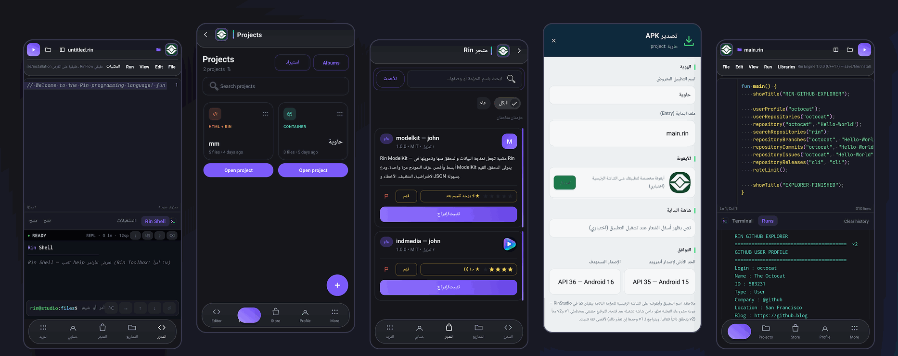

<div align="center">


# Rin

**لغة برمجة صغيرة وواضحة — محرّك C++17 واحد يعمل من سطر الأوامر والهاتف والمتصفح**

<sub>A small, readable programming language · one C++17 engine · CLI · Android IDE · WebAssembly</sub>

<p>
<a href="https://github.com/dlof-lib/rinlang/actions/workflows/rin__apk.yml"></a>

<a href="./LICENSE"></a>
</p>

<p>
<a href="https://dlof-lib.github.io/rinlang/"><b>الموقع</b></a> ·
<a href="./docs/getting-started.md"><b>البداية</b></a> ·
<a href="./docs/language-reference.md"><b>المرجع</b></a> ·
<a href="./lib/README.md"><b>المكتبات</b></a> ·
<a href="https://dlof-lib.github.io/rinlang/?view=libraries"><b>متجر الحزم</b></a> ·
<a href="./.changelog/CHANGELOG.md"><b>التغييرات</b></a>
</p>



</div>

## مثال

```kotlin
@import "lib/math.og.rin";

fun greet(name) {
    return "مرحباً يا " + name + "!";
}

print greet("Rin");
print factorial(5);      // 120
```

جرّبه الآن بلا تثبيت في [Playground](https://dlof-lib.github.io/rinlang/).

## التثبيت

```bash
git clone https://github.com/dlof-lib/rinlang.git
cd rinlang/cli/linux && ./build.sh      # cmake + g++ + zlib1g-dev
```

macOS: `cli/macos/build.sh` · Windows: `cli\windows\build.bat` · أندرويد: [RinStudio](./docs/android.md)

```bash
rin -c 'print 1 + 1;'        # كود مباشر
rin run hello.rin            # تشغيل ملف
rin check hello.rin          # فحص نحوي
rin new myproj               # مشروع جديد
rin doctor                   # فحص البيئة
```

كل الأوامر والتفاصيل: [`docs/getting-started.md`](./docs/getting-started.md).

## لماذا Rin؟

- **بسيطة**: متغيّرات ودوال و`enum` و`match` وأنابيب `|>`.
- **محرّك واحد**: النتيجة نفسها على CLI وأندرويد والمتصفح، بلا نسخ مكرَّرة.
- **واجهات مدمجة**: لغة Indsin بمعاينة حيّة.
- **82 مكتبة رسمية** ومدير حزم (RinPM) ومتجر على الويب.
- **ربط** مع Python وNode.js وC: [`bindings/`](./bindings/README.md).

## الوثائق

| | |
|---|---|
| البداية | [التثبيت والأوامر](./docs/getting-started.md) · [الصياغة](./docs/syntax.md) · [المتغيّرات](./docs/variables.md) |
| اللغة | [المرجع الشامل](./docs/language-reference.md) · [الدوال](./docs/functions.md) · [الحاويات](./docs/containers.md) · [الواجهات](./indsin.md) |
| الأدوات | [RinStudio](./docs/android.md) · [المكتبات](./lib/README.md) · [API](./docs/api.md) |
| المشروع | [المعمارية وبنية المستودع](./docs/architecture.md) · [CI](./docs/ci.md) · [لقطات](./docs/screenshots.md) |

الفهرس الكامل: [`docs/README.md`](./docs/README.md).

## المساهمة

نرحّب بكل مساهمة — اقرأ [`CONTRIBUTING.md`](./CONTRIBUTING.md) و[قواعد السلوك](./CODE_OF_CONDUCT.md).
للمساعدة: [`SUPPORT.md`](./SUPPORT.md) · للثغرات: [`SECURITY.md`](./SECURITY.md).

## الترخيص

[MIT](./LICENSE) © 2026 Rin Project Contributors.
الاسم والشعار غير مشمولين بالترخيص: [`TRADEMARKS.md`](./TRADEMARKS.md) · المكوّنات الخارجية: [`THIRD_PARTY_NOTICES.md`](./THIRD_PARTY_NOTICES.md).
