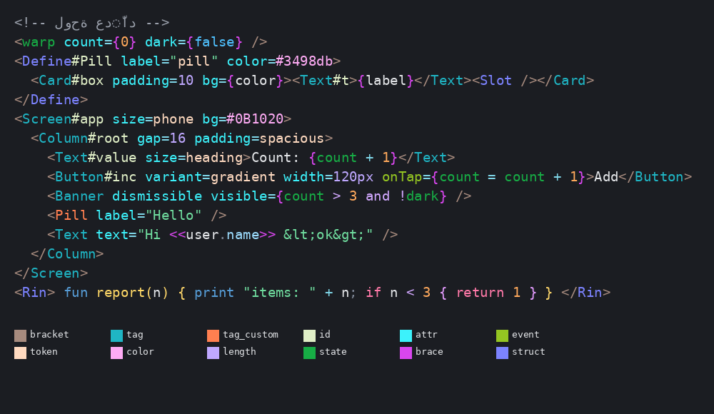
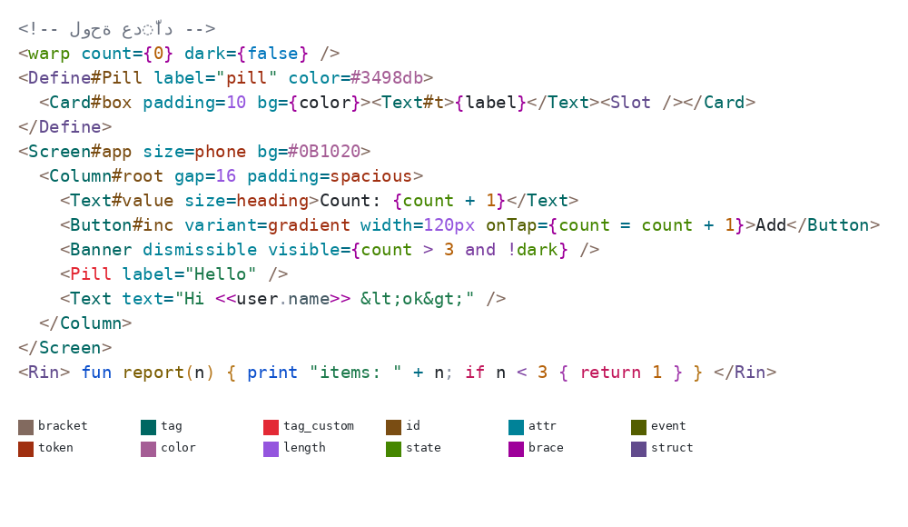

# تلوين indsin في المحرر

مُلوِّن مستقل (`app/src/main/cpp/editor/rin_indsin_highlight.h`) يُستعمل لملفات `.indsin` ولأي ملف `.rin` مكتوب بصياغة الوسوم
(`<Column#root …>`، `<warp …>`). أي ملف `.rin` عادي يبقى على مُلوِّن Rin الأصلي بلا تغيير.
في صياغة الوسوم يتوقف أيضاً تشغيل `rin::Parser` للتشخيص وفحص الأقواس (كانا يُنتجان أخطاء حمراء كاذبة على كل وسم).

## المبدأ: لكل نوع لون يميّزه
اثنا عشر دوراً دلالياً، مرتّبة في خمس عائلات (بنية · أسماء · سمات · قيم · حالة). اللوحتان (النهارية والليلية) مضبوطتان رقمياً:
* المسافة اللونية **CIEDE2000 ≥ 14** بين أي دورين، وبين كل دور وألوان Rin الأساسية (نص، رقم، نداء، ثابت، تحكّم، كلمة مفتاحية…).
* التباين مع الخلفية **≥ 4.5** (WCAG AA) في الوضعين.

| الدور | الأمثلة | نهاري | ليلي |
|---|---|---|---|
| bracket — أقواس الوسم | `<` `</` `>` `/>` | `#826A5F` | `#A78B7E` |
| struct — بنية/توجيه | `@view` `.end/view` `<Define>` `<If>` `<Fun>` `<Rin>` `<</each>>` | `#624B8D` | `#7C83FF` |
| brace — حدّا التعبير | `{ }` و `<< >>` | `#9E009A` | `#D946EF` |
| tag — مكوّن معروف | `Column` `Button` `Text` | `#006762` | `#1FB5C4` |
| tag_custom — مكوّن مخصّص | `<Pill>` (من `<Define>`) | `#E32935` | `#FF7F50` |
| id — معرّف العنصر | `#root` | `#7A4D13` | `#DFEEC6` |
| attr — سمة | `gap` `padding` | `#008298` | `#3CF2FB` |
| event — حدث | `onTap` `onLongPress` | `#545E00` | `#94C522` |
| token — قيمة تصميم | `spacious` `pill` `"primary"` | `#A02F10` | `#FFDAC0` |
| color — لون | `#0B1020` | `#A55D95` | `#FEABF4` |
| length — طول/زمن | `16` `120px` `250ms` `50%` | `#9455DE` | `#BFA8FF` |
| state — خلية warp | `count` في أي موضع | `#458600` | `#17AD45` |

داخل `{ … }` و`<< … >>` وكتل `<Fun>`/`<Rin>` يُلوَّن كود Rin بأنواعه المعتادة (نص، رقم، نداء، ثابت، تحكّم، مقارنة، أقواس بالتناوب حسب العمق).
أسماء خلايا `warp` تُستخرج من `<warp a={0} b={1} />` و`warp name = …;` وتُلوَّن كحالة في كل مكان تُقرأ فيه.
الألوان في `res/values/colors_indsin_syntax.xml` و`res/values-night/colors_indsin_syntax.xml`.

الاختبار: `tests/indsin_highlight/highlight_test.cpp` (يتضمن fuzz).
