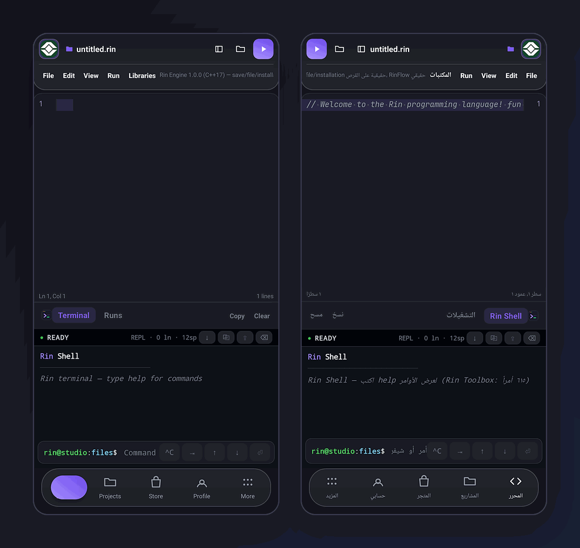
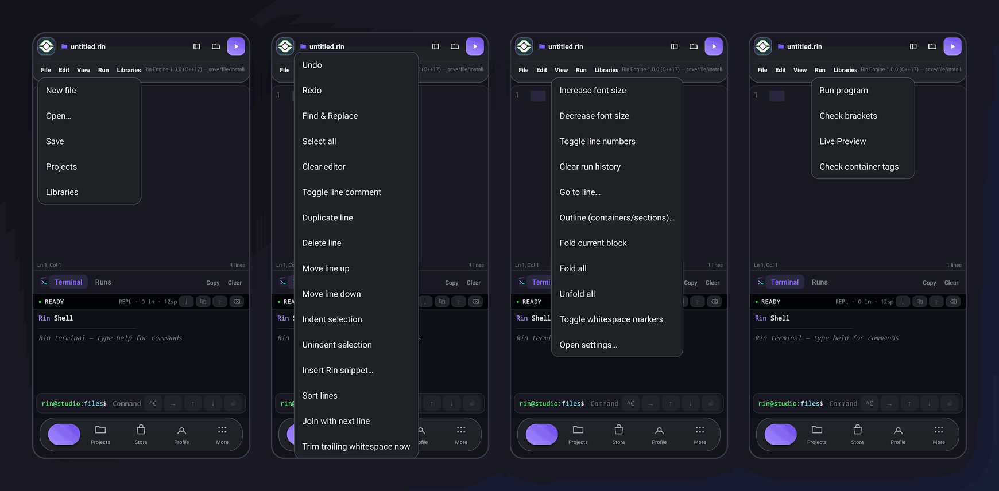
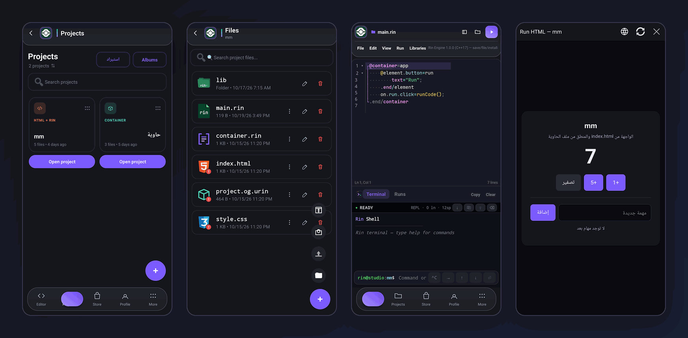
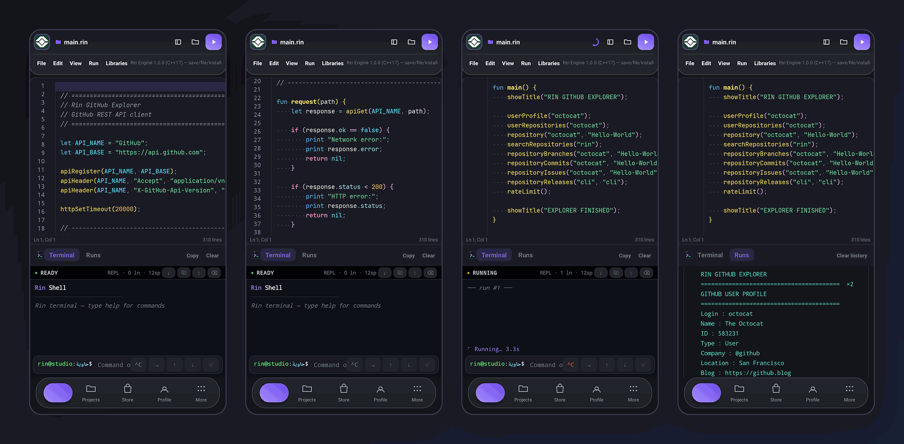
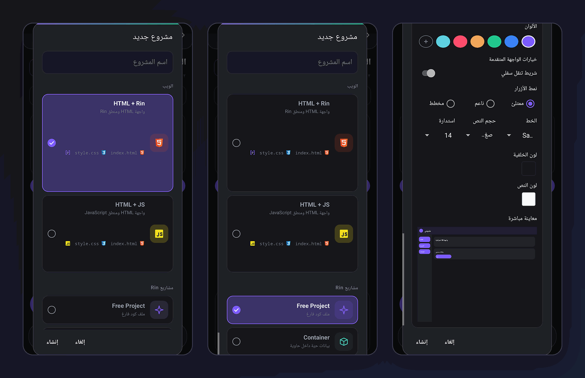
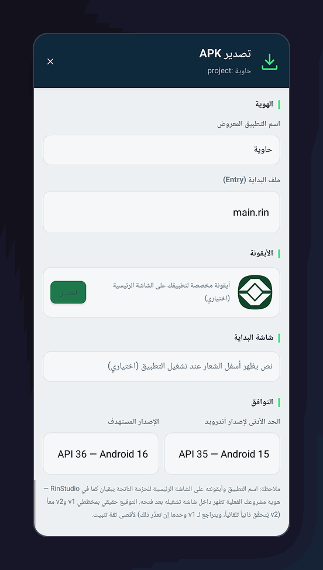
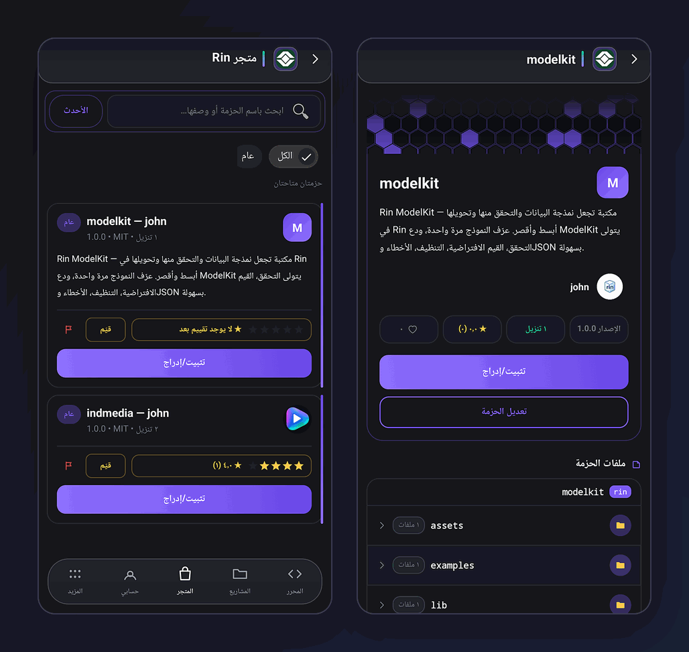

# لقطات من RinStudio

لقطات حقيقية من التطبيق (واجهة عربية وإنجليزية). الملفات في [`assets/screenshots`](./assets/screenshots).

## المحرّر والطرفية

محرّر بتلوين نحوي وعدّاد أسطر وطيّ للكتل، وتحته **Rin Shell** وتبويب **التشغيلات**.

## القوائم

`File` · `Edit` · `View` · `Run` — بحث واستبدال، طيّ، مخطط Outline، معاينة حيّة، فحص الأقواس والوسوم.

## المشاريع والملفات

مشروع **HTML + Rin**: الواجهة من `index.html` والمنطق من ملف الحاوية.

## تطبيق حقيقي: GitHub Explorer

برنامج Rin من 310 أسطر يستدعي واجهة GitHub REST ويعرض الملف الشخصي والمستودعات والإصدارات.

## مشروع جديد

قوالب **الويب** (HTML + Rin، HTML + JS) وقوالب **Rin** (Free · Container · Table · UI · Illust).

## تصدير APK

الاسم، ملف البداية، الأيقونة، شاشة البداية، والتوافق (API 35 / الهدف API 36).

## المتجر والحزم

بحث وتقييم وتثبيت بنقرة، وصفحة تفاصيل لكل حزمة.
